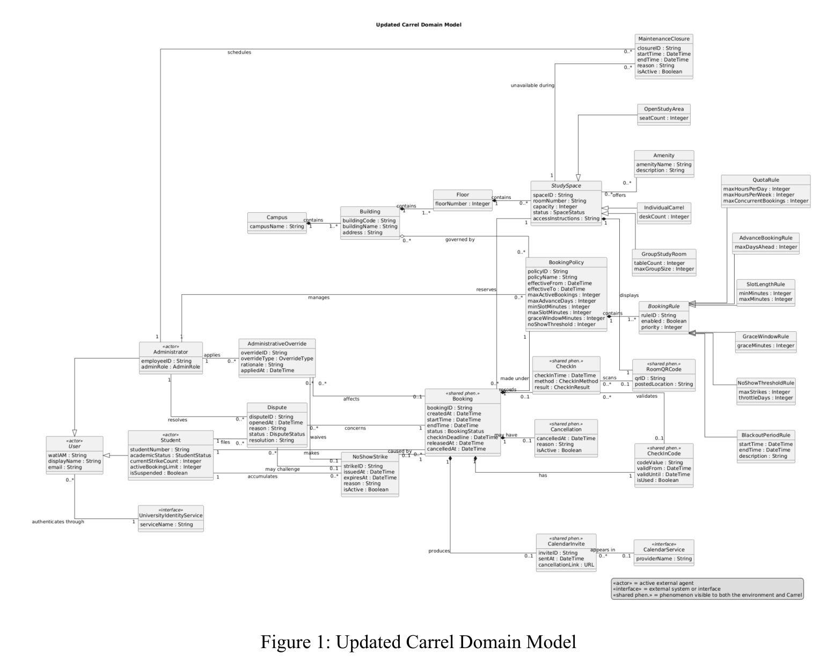
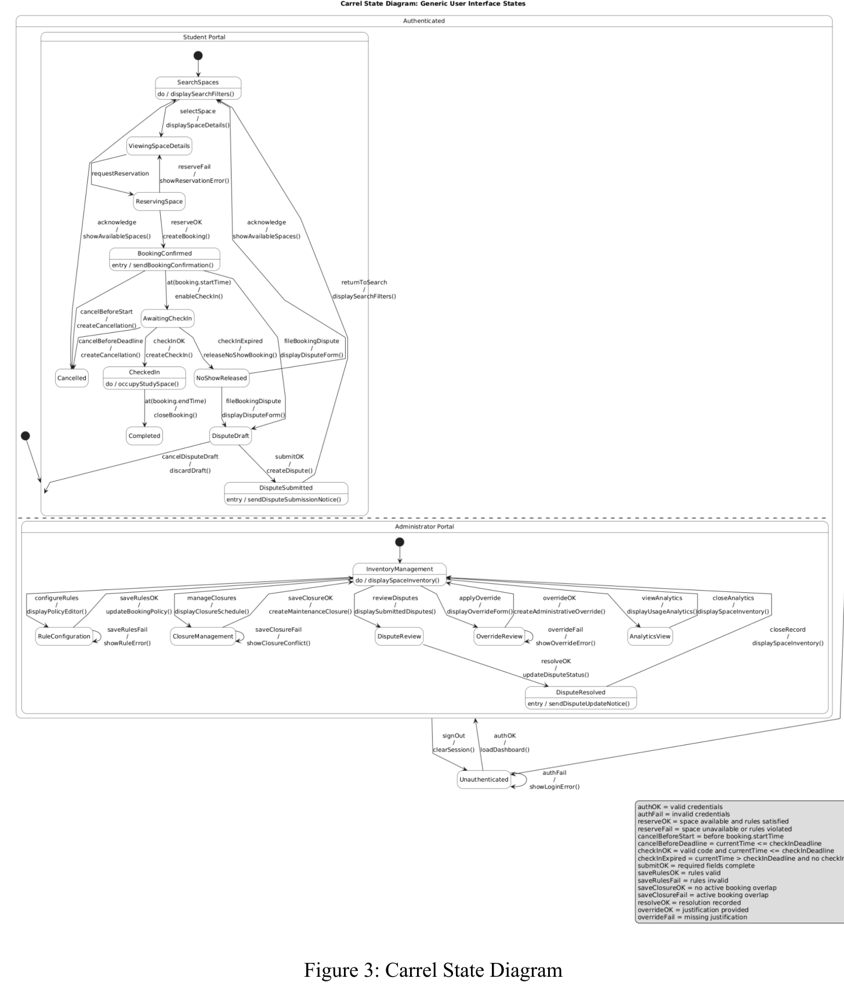
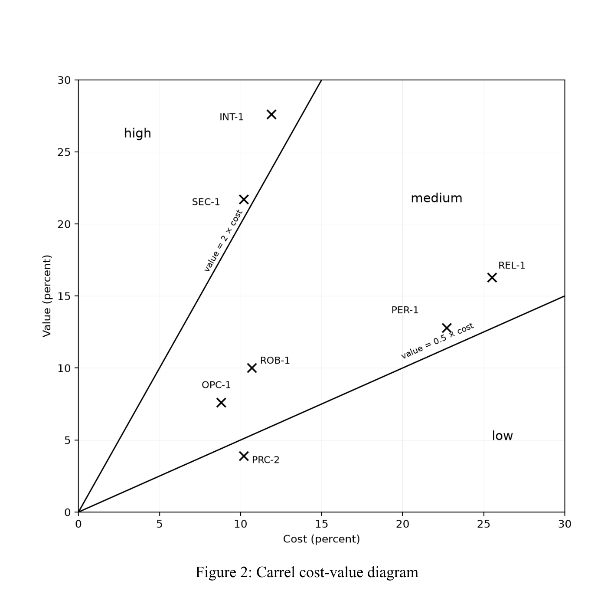
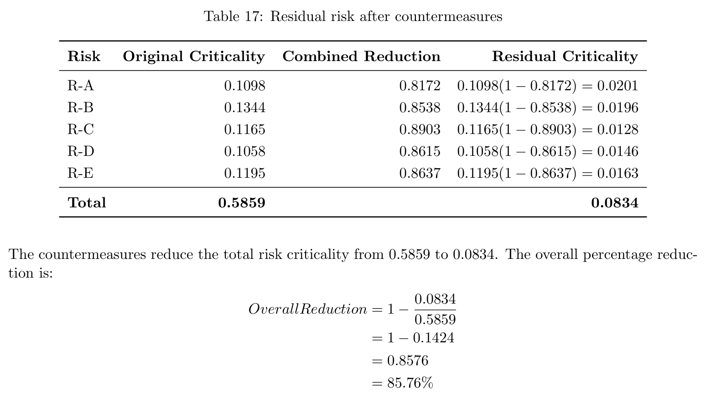

# Carrel — A Campus Study Space Booking System

Carrel is a requirements-engineering case study for a proposed campus-wide service that helps students find, reserve, and check in to suitable study spaces. The design prevents conflicting reservations, automatically releases no-shows, and gives administrators traceable controls for inventory, policies, closures, disputes, and overrides.

**[Explore the project site](https://y68wu.github.io/Carrel/)** · **[Read the complete English report](./docs/Carrel_Report_EN.md)**

> **Project status:** Carrel is a detailed specification and project-planning package, not a deployed product. Performance values in this repository are future test targets. Function-point, COCOMO, and risk values are analytical estimates or model outputs rather than production measurements.

## Why Carrel?

Campus study space is limited, but discovery and booking can be fragmented. Students need accurate information about time, location, capacity, amenities, and accessibility. Facilities teams need consistent rules, fewer unused reservations, and an auditable way to handle disputes and exceptions.

Carrel brings that work into one lifecycle:

1. Authenticate the student and establish the correct role.
2. Search spaces by date, time, building, capacity, and amenities.
3. Revalidate availability, eligibility, quotas, conflicts, and maintenance closures at submission time.
4. Create a confirmed booking, bounded check-in credential, notification, and calendar invitation.
5. Resolve the booking through check-in, cancellation, completion, no-show release, or dispute.

## Proposed capabilities

| Students | Administrators | Automated services |
| --- | --- | --- |
| Search and view suitable spaces | Manage space inventory | Authenticate through the university identity service |
| Reserve after policy and conflict checks | Configure quotas, windows, and penalties | Send notifications and calendar invitations |
| Check in with a code or QR credential | Schedule maintenance closures | Release eligible no-shows after the deadline |
| Review, cancel, and dispute bookings | Resolve disputes and log overrides | Preserve state for audit and analysis |

## Requirements engineering at a glance

| Artifact | Scope | Status |
| --- | ---: | --- |
| Updated core use cases | **17** | Design count |
| Formal operations | **5** | D4 specification count |
| OCL invariants | **12** | Logical requirements |
| Quality requirements | **21** | Three in each of seven categories |
| LTL properties | **10** | Temporal specifications |
| Estimated function points | **264 UFP** | Analytical estimate |

### Domain and behavior models

[](./pdfs/D4.pdf#page=3)

The updated domain model connects students, administrators, study spaces, bookings, check-ins, policies, closures, disputes, and external services. It is a conceptual model—not evidence of a completed physical database.

[](./pdfs/D4.pdf#page=14)

The behavioral model covers student and administrator portals, guarded transitions, booking outcomes, and dispute resolution. Five operation contracts define signatures, preconditions, allowed state changes, postconditions, and exception behavior.

## Quantitative quality targets

The D5 quality specification replaces vague words such as “fast” and “reliable” with measurable fit criteria:

| Area | Target | Meaning |
| --- | ---: | --- |
| Search response | **p95 ≤ 2.0 s** | Future target under the specified 500-session load |
| Booking response | **p95 ≤ 3.0 s** | Future validated-reservation target |
| Check-in throughput | **≥ 20 validations/s** | Sustained target |
| Service availability | **≥ 99.5%** | Academic-term target |
| No-show correctness | **≥ 99.9%** | Automated-release target |
| Automated statement coverage | **≥ 80%** | Core booking module process target |

[](./pdfs/D5.pdf#page=23)

## Formal constraints

Carrel uses three complementary levels of precision:

- **Operation contracts** describe the legal execution of reservation, check-in, cancellation, dispute submission, and no-show release.
- **OCL invariants** constrain persistent state, including valid time ranges, positive capacity, booking limits, closure conflicts, and usable check-in codes.
- **LTL properties** describe behavior across successive states, such as eventual booking confirmation and the integrity of active reservations.

The central overlap rule for half-open booking intervals is:

```text
(requestedStart < existingBooking.end) AND
(requestedEnd   > existingBooking.start)
```

This rejects genuine overlaps while allowing one booking to begin exactly when another ends.

## Planning and risk analysis

Function Point Analysis and organic COCOMO provide a planning baseline for the proposed scope:

| Estimate | Model output |
| --- | ---: |
| Unadjusted Function Points | **264 UFP** |
| Estimated source lines | **7,656 SLOC** |
| Estimated effort | **23.50 person-months** |
| Forecast duration | **8.30 months** |
| Average development staff | **2.83 people** |

The risk model considers five risks and associated countermeasures. Under its stated assumptions, weighted criticality falls from **0.5859** to **0.0834**, a modeled reduction of **85.77%** when recomputed from those displayed totals. This percentage is not a measured improvement from an implemented system.

[](./pdfs/D6.pdf#page=20)

## Project documentation

| Deliverable | Central question | PDF |
| --- | --- | --- |
| D1 | What problem should Carrel solve, and where is its boundary? | [Project Scope & Product Perspective](./pdfs/D1.pdf) |
| D2 | Who is affected, and what concepts exist in the domain? | [Domain Model & Stakeholder Analysis](./pdfs/D2.pdf) |
| D3 | What goals do actors achieve, including alternate and exceptional flows? | [Use Case Diagram & Descriptions](./pdfs/D3.pdf) |
| D4 | When is each action legal, and how does state change? | [Functional Model, OCL & State Diagram](./pdfs/D4.pdf) |
| D5 | How should quality be measured and requirements prioritized? | [Quality Requirements & Prioritization](./pdfs/D5.pdf) |
| D6 | What effort, risks, mitigations, and long-term rules shape delivery? | [Cost, Risk & LTL Constraints](./pdfs/D6.pdf) |
| D7 | What does requirements-engineering research add to project practice? | [Software Project Management & RE Research](./pdfs/D7.pdf) |

## Team

**The Reservists** — Kevin Wang, Chris Wu, and Rui Lin<br>
CS 445 / SE 463 / CS 645 · University of Waterloo · Spring 2026

Public document copies omit student numbers, course-account identifiers, and grade references for privacy. The public GitHub handle in repository URLs is intentionally retained; the substantive project content is preserved.
